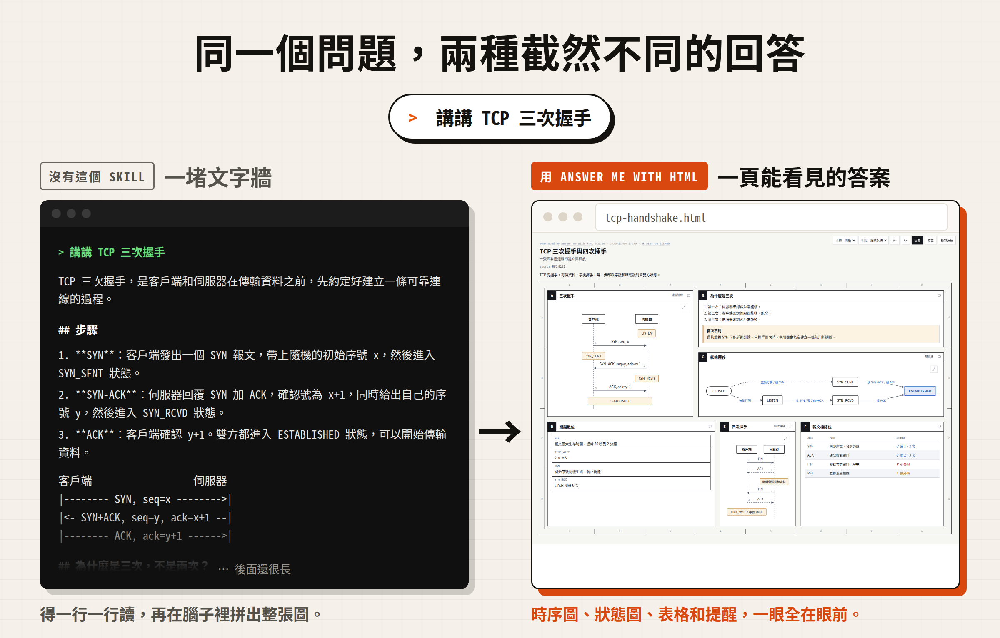
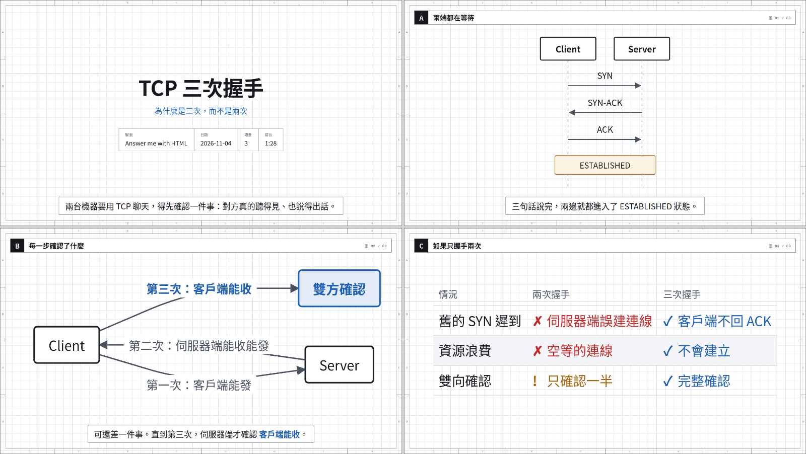
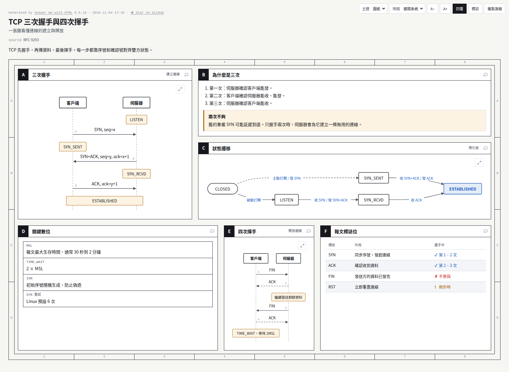
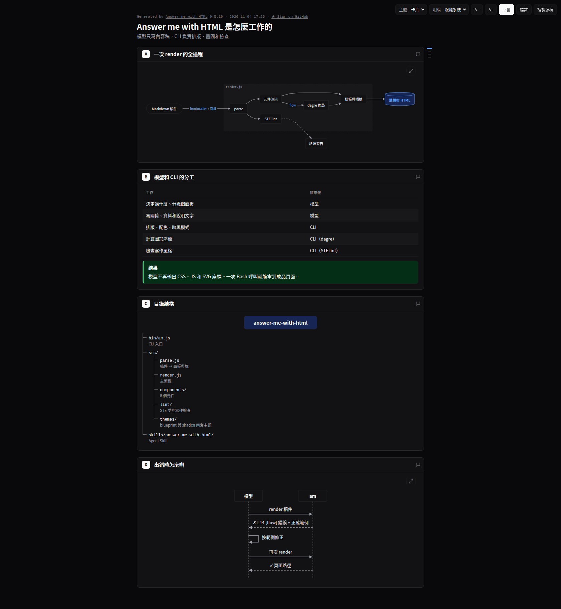

<p align="center">
  
</p>

<h1 align="center">Answer me with HTML</h1>

<p align="center">
  <b>極速出頁&nbsp;&nbsp;|&nbsp;&nbsp;ASD-STE100&nbsp;&nbsp;|&nbsp;&nbsp;講解影片&nbsp;&nbsp;|&nbsp;&nbsp;單檔案離線</b>
</p>

<p align="center">
  <b>一個 Agent Skill：遇到複雜問題，Agent 不再甩給你一堵文字牆，而是給你一頁能看懂的 HTML。<br>模型要寫的 token，只有它直接手寫 HTML 的約 1/8。</b>
</p>

<p align="center">
  <a href="https://github.com/doggy8088/answer-me-with-html/releases"></a>
  <a href="https://github.com/doggy8088/answer-me-with-html/stargazers"></a>
  
  <a href="https://www.theagenticleaderboard.com/alternatives/answer-me-with-html/"></a>
  <a href="https://ko-fi.com/yunqing_love"></a>
  <a href="https://afdian.com/a/cyan_yunchen"></a>
</p>

<p align="center">
  <a href="https://answer-me-with-html.com/zh/"><b>官網</b></a> · <a href="#安裝">安裝</a> · <a href="#你說什麼會得到什麼">範例</a> · <a href="#解釋影片">影片</a> · <a href="#高頻模式推薦">高頻模式</a> · <a href="docs/reference.zh-TW.md">參考文件</a> · <a href="README.md">English</a>
</p>

<p align="center">
  
</p>

裝好之後，像平時一樣提問就行：

```
> 講講 TCP 三次握手和四次揮手
> 畫一下這個倉庫的模組關係
> Redis 和 Memcached 該怎麼選
```

Agent 會寫一份很短的 Markdown 稿件，交給 skill 自帶的 CLI。大約 50 毫秒後，你就得到一頁：

https://github.com/user-attachments/assets/1f13b1fe-70a9-4c39-8530-b12e553e17ea

<p align="center"><sub>24 秒示範，打開聲音可以聽到配樂。</sub></p>

## 為什麼不直接讓 AI 輸出 HTML？

當然可以，現在的模型寫 HTML 已經寫得不錯了。但它寫的大部分都不是內容。我們數了 9 頁模型直接手寫的 HTML，平均 4,893 個 token：

| 頁面裡的部分 | 佔比 | 用這個 skill 後 |
| :--- | ---: | :--- |
| SVG 圖：座標和路徑 | 47% | 由 CLI 生成 |
| CSS | 15% | 由 CLI 生成 |
| HTML 標記 | 17% | 由 CLI 生成 |
| 正文文字 | 21% | 模型來寫，寫成 Markdown |

用這個 skill，模型只寫一份 Markdown 稿件。同樣的問題，稿件平均 612 個 token，**約為手寫 HTML 的 1/8**。要寫的少，等的時間就短（3 個題目 × 每題 3 次，取中位數，Claude Sonnet 5.5，普通的 Claude Code 環境）：

| | 直接要 HTML | Answer me with HTML | |
| :--- | ---: | ---: | :--- |
| 模型要寫的 token | 4,893 | **612** | **少 8 倍** |
| 耗時 | 31 秒 | **12 秒** | **快 2.6 倍** |

<p align="center">
  
</p>

<p align="center"><sub>同一個問題、同一個模型，兩種做法各答一遍，兩頁都能用。</sub></p>

token 數存在 [bench/corpus/tokens.json](bench/corpus/tokens.json) 裡，執行 `node bench/corpus.mjs` 每次都得到同樣的數位。頁面本身可以[下載](https://github.com/doggy8088/answer-me-with-html/releases/download/v0.4.14/bench-corpus-2026-10-07.zip)。花費降得比 token 少，這裡約便宜 15%，因為每一輪都還要讀系統提示、你的問題和對話記錄，用不用 skill 都一樣。詳見[花費都花在哪](bench/README.md#where-the-cost-goes)。

解釋影片省得更多：在[一次小測試](bench/README.md#explainer-videos)裡，輸出 token 少約 18 倍，快約 12 倍。

## 安裝

需要本機裝有 [Node.js](https://nodejs.org/) 20 或更高版本。不需要 `npm install`，CLI 已經封裝在 skill 裡了。還沒裝 Node.js？用下面推薦的方式安裝，Agent 會先問你，再替你裝好。

### 讓 Agent 幫你裝（推薦）

把下面這段話粘貼給你的 Agent。Claude Code、Codex、Cursor、OpenCode 都可以：

> 幫我安裝 Answer me with HTML：讀 https://raw.githubusercontent.com/doggy8088/answer-me-with-html/main/INSTALL.md，照著做。

[INSTALL.md](INSTALL.md) 是寫給 Agent 看的。它在 Claude Code 裡裝外掛，在其他 Agent 裡裝 skill，已有安裝會保留，除非缺少 Node.js 或版本低於 20，否則全程不向你提問，用"TCP 三次握手"頁面驗證後給你一份彙報。如果你的 Agent 打不開連結，用 `npx -y skills add doggy8088/answer-me-with-html -g -y -a <你的 Agent 名>`（Claude Code 是 `-a claude-code`）。

### Claude Code 外掛

在 Claude Code 裡執行：

```
/plugin marketplace add doggy8088/answer-me-with-html
/plugin install answer-me-with-html@answer-me-with-html
```

### DeepSeek Harness 外掛

在終端裡執行。換成你在用的 profile，自帶的是 `web`：

```bash
dsh plugin --profile web add github:doggy8088/answer-me-with-html
```

### 一條命令

```bash
npx skills add doggy8088/answer-me-with-html
```

它會問你裝到哪個 Agent。安裝器來自 [vercel-labs/skills](https://github.com/vercel-labs/skills)，支援 70 多種 Agent。

<details>
<summary>手動安裝</summary>

把 `skills/answer-me-with-html` 這個目錄放進你的 Agent 的 skill 目錄就行。以 Claude Code 為例：

```bash
git clone --depth 1 https://github.com/doggy8088/answer-me-with-html.git /tmp/answer-me-with-html
cp -R /tmp/answer-me-with-html/skills/answer-me-with-html ~/.claude/skills/answer-me-with-html
```

其他 Agent 的 skill 目錄：Codex 是 `~/.codex/skills/`，Cursor 是 `~/.cursor/skills/`，OpenCode 是 `~/.config/opencode/skill/`。

</details>

裝好後不需要任何組態。**建議打開[高頻模式](#高頻模式推薦)**：Agent 會給每個結論都附一頁，而不只是複雜問題。只需要在規則檔案里加一條規則。

## 你說什麼，會得到什麼

| 你說 | 你會得到 |
| :--- | :--- |
| "講講 TCP 三次握手" | 時序圖、狀態遷移圖、標誌位對照表 |
| "這個倉庫的模組是怎麼組織的" | 目錄結構樹，加一張模組呼叫關係圖 |
| "Redis 和 Memcached 怎麼選" | 多維對比表，用 ✓ ✗ 標出差異，最後給結論 |
| "這段文案哪裡寫得不好" | 逐句標註，標出問題詞和改法 |
| "Kubernetes 是怎麼發展起來的" | 時間線，關鍵節點高亮 |
| "給快取改造做個方案" | 直接引用檔案裡的真實程式碼，待定的問題做成選項，在頁面上就能回答 |
| "`ls` 怎麼看隱藏檔案" | 不出頁面。一句話能說清的問題照常回答 |

要不要出頁面由 Agent 判斷：概念之間關係複雜、有多步流程、要做多維對比，才會出頁面。你也可以直接說"用 HTML 講一下……"。

頁面儲存在 `~/.answer-me-with-html/pages/`。頁面右上角可以切換主題、切換亮暗、彙總你的回覆，也可以複製生成這一頁的 Markdown 原稿。

## 和 Archify、GenUI 外掛有什麼不同？

[Archify](https://github.com/tt-a1i/archify) 根據一份 JSON 規格畫一張可交互的圖。[dsh-genui](https://github.com/omdsh-dev/dsh-genui) 這類 GenUI 外掛在某一個聊天應用裡顯示元件。這個 skill 把整個問題答成一頁：正文、表格、程式碼和圖都有，模型只寫一份 Markdown 稿件，任何能執行 shell 命令的 Agent 都能用。詳見[完整對比](docs/compare.zh-TW.md)。

## 解釋影片

Karpathy 說的"理解 LLM 輸出"階梯，最後一級是 3Blue1Brown 風格的解釋影片。直接說"給 TCP 握手做個 3b1b 風格的影片"就行。

<p align="center"></p>

Agent 寫的稿件和頁面稿一樣，只是多了旁白，每行一拍：

````markdown
## 兩端都在等待
```sequence
Client -> Server: SYN
Server -> Client: SYN-ACK
```
> 先是客戶端開口，發一個 SYN，意思是"我想跟你建個連線"。
> [Server] 聽到了，回一個 SYN-ACK："收到，我這邊也沒問題。"
````

`am video` 把它做成一個播放頁：圖隨旁白一步步畫出來，鏡頭跟著方括號裡的節點走。配音內嵌在頁面裡，離線也能播。播放器帶章節欄（在場景之間跳轉）、倍速按鈕，以及一個匯出按鈕 —— 同一個影片由瀏覽器自己編碼並下載（本機檔案或 `localhost` 打開即可，不需要 ffmpeg）。加 `--mp4` 另存 MP4 檔案（需要 ffmpeg），加 `--webm` 另存由頁面自己編碼的 WebM 檔案（不需要 ffmpeg）。只有你要影片時 Agent 才會做。細節見[解釋影片的細節](docs/video.zh-TW.md)。

## 組態

用斜槓命令改組態，不用手動編輯組態檔。

| 在哪裡 | 怎麼改 |
| :--- | :--- |
| Claude Code（外掛安裝） | `/answer-me-with-html:config` 會問你要改什麼；`/answer-me-with-html:config open off` 直接改 |
| 任意 Agent | `/answer-me-with-html config open off`，或者直接說"別再自動彈瀏覽器了" |
| 終端 | `am config` 查看，`am config set open off` 修改，`am config reset` 恢復預設 |

組態項有 `open`（自動打開瀏覽器）、`theme`、`mode`（亮色或暗色）、`style`（寫作檢查）、`scale`（頁面文字大小，圖表跟著變大）、`update_check`、`close_after_reply`（複製回覆後關閉標記頁）和 `voice`（影片配音）。預設值和可選值見[參考](docs/reference.zh-TW.md#組態)。

## 高頻模式（推薦）

打開高頻模式後，**每個結論都會附一頁**：只要這一輪給出了結論、總結、方案或對比，哪怕回答很短，Agent 也會順手出一頁 2～4 個面板的小頁面，並在回覆最後附上路徑。這些頁面只生成、不彈出，不會打斷你手上的事。閒聊、沒有結論的一兩句話不受影響。Claude Code 處於 plan 模式時不會出頁面。

預設是關的。建議打開：不用每次開口要頁面，短結論也和長篇一樣好讀。頁面會堆在 `~/.answer-me-with-html/` 裡，用 `am clean` 清理。想打開，把下面這段話粘貼給你的 Agent，讓它寫進自己的規則檔案（比如 `~/.claude/CLAUDE.md` 或 `AGENTS.md`）：

> 幫我打開 Answer me with HTML 的高頻模式：在你的全域規則檔案里加一條規則——"[answer-me-with-html always-on] 只要回覆裡給出了結論、總結、方案、對比、評審或講解，就同時用 answer-me-with-html skill 生成一頁 HTML（日常結論用 2～4 個面板），先渲染頁面，再寫文字回覆，回覆最後按 SKILL.md 對當前宿主的要求附上頁面連結，不要先寫文字再渲染。哪怕回答很短也要出，不要因為答案不長就跳過。渲染時加 --no-open，不要彈出瀏覽器。閒聊、沒有結論的一兩句話、純命令輸出、我要求純文字時除外。另外，子 Agent 向父 Agent 彙報屬於內部材料，不是給使用者的回覆：按父 Agent 的要求返回完整結論與證據，除了任務明確要求出頁面，否則不要生成頁面。"

想關掉，把這條規則刪掉即可。想讓頁面少一點？見[少一點主動](docs/reference.zh-TW.md#少一點主動)。

## 更新與清理

需要手動更新。使用時，CLI 最多每天在後台向 GitHub 查一次新版本；有新版本時，最多每三天向 Agent 提示一次，不會上傳任何內容。想更新，對 Agent 說"更新一下 answer-me-with-html"。頁面會堆在 `~/.answer-me-with-html/` 裡，說"清理一下頁面"，Agent 會先問你再刪。其他安裝方式和全部選項見[參考](docs/reference.zh-TW.md#更新與清理)。

## 為什麼做這個

Karpathy 發過[一條推文](https://x.com/karpathy/status/2105819303471976479)。大意是 LLM 乾的活越來越多，人反而越來越難跟上它的輸出。比起讀一大段文字，看一張圖、一頁網頁要輕鬆得多。

我試過讓 Agent 直接用 HTML 回答問題。頁面不錯，就是太慢：一頁像樣的網頁要等一兩分鐘，大半時間花在輸出幾百行每次都差不多的 CSS 上。畫流程圖更麻煩：模型得自己算 SVG 座標，箭頭經常指到空白處。

所以 Answer me with HTML 把這些活從模型手裡拿走了。模型只寫內容，排版、配色、畫圖都交給 CLI。

## 原理

模型只需要寫這樣一份稿件：

````markdown
---
title: TCP 三次握手與四次揮手
---
## A 三次握手 {span=2}
```sequence num
客戶端 -> 伺服器: SYN, seq=x
伺服器 -> 客戶端: SYN+ACK, seq=y, ack=x+1
客戶端 -> 伺服器: ACK, ack=y+1
note 客戶端, 伺服器: ESTABLISHED
```

## C 狀態遷移 {span=2}
```flow LR
(CLOSED) -> LISTEN: 被動打開
LISTEN -> SYN_RCVD: 收 SYN / 發 SYN+ACK
SYN_RCVD -> *ESTABLISHED: 收 ACK
```
````

剩下的都由 CLI 完成：選樣板、排面板、套主題，用 [dagre](https://github.com/dagrejs/dagre) 算流程圖座標，按標記寬度拉開時序圖間距。完整稿件 [examples/tcp.md](examples/tcp.md) 會生成這一頁：

<p align="center">
  
</p>

## 特性

- **版面由程式碼計算:** 面板位置和圖形座標都是算出來的，不靠模型猜。文字不會被截斷，網格里也不會留空洞。
- **出錯能自己改:** 稿件寫錯時，CLI 會給出行號、元件名和一段正確範例。Agent 照著改一次就行。
- **三套主題:** blueprint 是圖紙風，shadcn 是卡片風，paper 適合讀長文。預設由 CLI 按內容自動選：長文用 paper，有圖表用 blueprint。三套都帶亮色和暗色，頁面上可以用下拉框隨時切換，也可以新增你自己的主題，或者從[主題庫](https://answer-me-with-html.com/zh/themes/)裡取一個。
- **單檔案、零依賴:** 產物是一個 `.html`，不引用任何 CDN 或外部字體。斷網也能打開，發給別人也能看。
- **多語言:** 簡體中文、繁體中文、英文和日文都有對應的按鈕和字體。其他語言也能用，按鈕是英文。詳見[語言](docs/reference.zh-TW.md#語言)。
- **寫作檢查:** 按 ASD-STE100 的思路檢查稿件裡的文字。句子太長、用詞太繞、被動語態都會提醒。預設只提醒，不攔著。
- **真實程式碼，不靠手抄:** 程式碼塊可以直接引用你檔案裡的幾行（`src=` `lines=`），頁面上的程式碼就是真實程式碼。當前目錄以外的檔案和存放密鑰的檔案會被拒絕。
- **在頁面上回復:** 可以對任意麵板寫評論，也可以在 Agent 提出的決定（`ask`）裡選選項。點"回覆"按鈕，你的選擇和評論會合成一段文字，貼回給 Agent 即可。
- **能找回原稿:** 每頁都內嵌了生成它的 Markdown。點"複製源稿"就能拿回來改。

<table>
  <tr>
    <td width="50%"></td>
    <td width="50%"></td>
  </tr>
  <tr>
    <td align="center"><sub>blueprint 圖紙風（<a href="examples/ste100.md">examples/ste100.md</a>）</sub></td>
    <td align="center"><sub>單欄長文樣板 + 暗色（<a href="examples/architecture.md">examples/architecture.md</a>）</sub></td>
  </tr>
</table>

## 元件

Agent 會按資訊的形狀挑元件：

| 元件 | 適合什麼 |
| :--- | :--- |
| `flow` | 架構、呼叫鏈、決策分支。自動佈局，支援分組、判斷框、資料庫 |
| `er` | 資料模型：實體帶欄位（PK / FK / UK）和鴉爪式關係連線 |
| `sequence` | 幾方之間按時間順序來回發訊息 |
| `tree` | 目錄、模組、分類體系 |
| `timeline` | 歷史、版本、階段 |
| `limits` | 當前值和上限的對比 |
| `chart` | 用數位表格畫柱狀圖、折線圖或餅圖：多個系列、負值、高亮一行 |
| `annot` | 逐詞點評一句話 |
| `kv` | 元資訊、圖紙標題欄 |
| `callout` | 結論、提示、警告 |
| `ask` | 需要你在頁面上做的決定，Agent 的建議項帶標記，所有選項開始時都不選中 |
| 程式碼塊 | 從檔案引用的真實程式碼（`src=` `lines=`），或手寫的示意程式碼 |
| 表格 | 多維對比。單元格寫 `ok` / `no` / `warn` 會變成 ✓ ✗ !；表格後寫 `{table sort filter}` 可開啟交互排序和篩選 |

稿件格式（frontmatter、`span`、`rows`、原始 `html`/`svg` 塊）和不經過 Agent 直接用命令列：見[參考](docs/reference.zh-TW.md)。每個元件的完整寫法：`am help <元件名>`。

## STE 受控寫作檢查

[ASD-STE100](https://www.asd-ste100.org/) 是一套受控英語，最早用來寫飛機維修手冊。它的規定很具體：句子不能太長，一個詞只表達一個意思，操作步驟要用祈使句。Karpathy 提到，讓 LLM 按這套規則寫，讀起來會清楚很多。

每次渲染都會檢查其中容易用機器檢查的部分：句長、常用詞、被動語態，以及中文的錯別字和含糊詞。預設只提醒。用 `/answer-me-with-html:config style strict` 讓不達標的稿件不生成，或者在單篇稿件裡寫 `style:`。完整規則見[參考](docs/reference.zh-TW.md#寫作檢查)。

## 開發

```bash
git clone https://github.com/doggy8088/answer-me-with-html.git && cd answer-me-with-html
npm install
npm test          # 跑測試
AM_E2E=1 npm test # 連同影片端到端測試一起跑（需要系統 TTS、Chrome、ffmpeg）
npm run smoke:install # 用 npx skills 真實安裝一次，並校驗外掛清單（需要聯網）
npm run build     # 改了 src/ 之後，重新封裝 skills/answer-me-with-html/scripts/am.mjs
npm run snapshot  # 與 origin/main 對比生成的 HTML（重構不能改變它）
```

維護約定（生成的封裝檔案、頁面格式、快照比對、審 PR、發版）見 [CONTRIBUTING.md](CONTRIBUTING.md)。

執行時期依賴只有兩個：[marked](https://github.com/markedjs/marked) 負責解析 Markdown，[@dagrejs/dagre](https://github.com/dagrejs/dagre) 負責流程圖佈局。封裝時它們會被一起打進 `am.mjs`。

## 社群

有問題、想分享做出來的頁面、有功能建議，或者只是想打個招呼，都歡迎來。

- [Discord](https://discord.gg/sYQuRRZNzQ)
- QQ 群：`1127099407`
- [LINUX DO](https://linux.do) 中文開發者論壇
- [AtomGit](https://atomgit.com/weixin_43367137/answer-me-with-html)

發現 bug 請提 [GitHub issue](https://github.com/doggy8088/answer-me-with-html/issues)。

## Star 歷史

<a href="https://star-history.com/#doggy8088/answer-me-with-html&Date">
  <picture>
    <source media="(prefers-color-scheme: dark)" srcset="https://api.star-history.com/svg?repos=doggy8088/answer-me-with-html&type=Date&theme=dark" />
    <source media="(prefers-color-scheme: light)" srcset="https://api.star-history.com/svg?repos=doggy8088/answer-me-with-html&type=Date" />
    
  </picture>
</a>

## License

[MIT](LICENSE)。主題可以內嵌的 Bangers 字體使用 [SIL Open Font License 1.1](skills/answer-me-with-html/licenses/OFL-Bangers.txt)。
